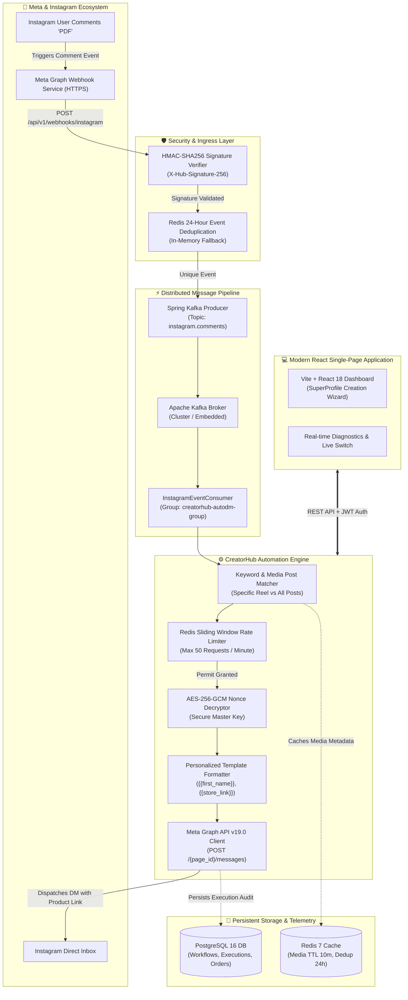

<div align="center">

# ⚡ CreatorHub

### **The Enterprise-Grade Digital Storefront & Event-Driven Instagram AutoDM Engine for Modern Creators**

[](https://spring.io/projects/spring-boot)
[](https://openjdk.org/)
[](https://react.dev/)
[](https://www.typescriptlang.org/)
[](https://developers.facebook.com/)
[](https://kafka.apache.org/)
[](https://redis.io/)
[](https://www.postgresql.org/)
[](https://en.wikipedia.org/wiki/Galois/Counter_Mode)
[](#-testing--quality-assurance)

<br/>

> **CreatorHub** transforms your Instagram audience into loyal customers and recurring revenue. Connect your Instagram Professional account, bind custom automated reply workflows to posts or Reels, configure trigger keywords like **`PDF`**, and convert comments into private direct messages with digital product links in sub-second latency.

[Explore Features](#-core-capabilities) • [System Architecture](#-system-architecture) • [Quick Start](#-quick-start) • [Security & Compliance](#-enterprise-security--token-protection) • [API Specification](#-api-endpoints)

---

</div>

<br/>

## 🌟 Core Capabilities

| Feature | Description | Enterprise Highlights |
| :--- | :--- | :--- |
| 🚀 **Real Instagram AutoDM Engine** | Automatically delivers private Direct Messages & public replies when followers comment on targeted Posts or Reels. | Keyword matching (`PDF`, `BLUEPRINT`), dynamic personalization (`{{first_name}}`, `{{store_link}}`), 7-day messaging window compliant. |
| 🔐 **Official Meta OAuth 2.0 & Discovery** | Official Authorization Code flow with signed HMAC-SHA256 CSRF states and long-lived token exchange. | Automatic Facebook Page & Instagram account discovery via `/me/accounts`. Zero fake accounts, genuine connection validation. |
| 🛡️ **AES-256-GCM Token Cryptography** | Master encryption key loaded from environment variables with randomized 12-byte IV/nonce per encryption. | Authenticated ciphertext prevents tampering. Tokens are never transmitted to browser frontend or committed to source control. |
| ⚡ **Resilient Event Pipeline (Kafka + Redis)** | Meta webhook ingress with HMAC-SHA256 constant-time signature verification routed to Kafka consumers. | **50 req/min** Redis sliding window rate limiter protects account reputation. **24-hr webhook deduplication** prevents double-replies. |
| 🏪 **Creator Storefront & 1-Click Checkout** | Full-featured digital storefront with instant file downloads, bundle pricing, and audience telemetry. | Real-time order creation, customer segmentation, customer lifetime value tracking, and custom subdomain slugs (`/@username`). |
| 🤖 **AI Assistant & Product Knowledge Base** | LLM-driven response engine trained on creator product FAQs and multi-tone presets. | Professional, casual, persuasive, and technical tone presets with grounding filters to prevent hallucinations. |
| 📊 **Mission-Control Diagnostics Dashboard** | Real-time monitoring of OAuth tokens, permissions, Kafka broker health, Redis rate limits, and dispatch mode. | Safe **DRY_RUN** simulation mode with one-click **LIVE Mode** toggle and full database execution audit trail. |

<br/>

---

## 🏛 System Architecture

The following diagram illustrates the complete end-to-end data flow from Instagram user interactions to automated delivery and storefront purchases:



<br/>

---

## 🛠 Tech Stack & Specifications

### **Backend Architecture**
* **Runtime**: Java 21 LTS
* **Framework**: Spring Boot 3.3.4 (Web, Security, Data JPA, Validation, Actuator)
* **Message Broker**: Apache Kafka (Spring-Kafka with automatic asynchronous in-memory queue fallback)
* **Caching & Rate Limiting**: Redis 7 Alpine (`spring-boot-starter-data-redis` with resilient sliding-window in-memory fallback)
* **Database**: PostgreSQL 16 with Flyway Database Versioning (`V1` through `V4`)
* **Security & Crypto**: Spring Security 6, JWT (HMAC-SHA256 tokens), AES-256-GCM cipher encryption
* **External Integration**: Official Meta Graph API v19.0+ Authorization Code OAuth 2.0

### **Frontend Architecture**
* **Framework**: React 18.3 with TypeScript 5.5
* **Build Tooling**: Vite 8.3 & Rolldown Bundler
* **Styling**: Modern Vanilla CSS Design System with responsive glassmorphism, tailored gradients, and dark mode
* **Icons**: Lucide React
* **State & Networking**: Custom JWT Authenticated API Client with automatic token rotation and retry subscribers

<br/>

---

## 🔐 Enterprise Security & Token Protection

```
┌────────────────────────────────────────────────────────────────────────┐
│                      Meta Token Security Model                         │
├────────────────────────────────────────────────────────────────────────┤
│ 1. Zero Exposure: Raw tokens never returned to browser or frontend.   │
│ 2. AES-256-GCM Authenticated Encryption:                               │
│    Ciphertext = E(K, IV, Plaintext, AAD)                               │
│    • K: 256-bit secure secret loaded from META_ENCRYPTION_KEY          │
│    • IV: Cryptographically random 12-byte nonce per record             │
│    • Tag: 128-bit authentication tag protecting against tampering      │
│ 3. State Validation: Cryptographic HMAC-SHA256 signature validates     │
│    workspace and user ownership on OAuth callback.                     │
│ 4. Rate Limiting: Redis sliding window prevents account flagging.      │
└────────────────────────────────────────────────────────────────────────┘
```

<br/>

---

## 🚀 Quick Start

### 1. Prerequisites
* **Java 21** or higher (`java -version`)
* **Node.js 18+** & npm (`node -v`)
* **Docker & Docker Compose** (Optional, for running PostgreSQL, Kafka & Redis containers)

### 2. Clone the Repository
```bash
git clone https://github.com/narayan1483/CreatorHub.git
cd CreatorHub
```

### 3. Environment Configuration
Copy the template `.env.example` to `.env` in the root folder:
```bash
cp .env.example .env
```
Fill in your credentials:
```ini
# Meta Developer Configuration
META_APP_ID=your_meta_app_id
META_APP_SECRET=your_meta_app_secret
META_VERIFY_TOKEN=meta_webhook_secret_verify_token_2026
META_ENCRYPTION_KEY=your_32_character_aes_encryption_key_here!
META_REDIRECT_URI=http://localhost:5173/auth/meta/callback

# Database & Broker
DB_HOST=localhost
DB_PORT=5432
DB_NAME=creatorhub
DB_USERNAME=postgres
DB_PASSWORD=postgres
KAFKA_BOOTSTRAP_SERVERS=localhost:9092
REDIS_HOST=localhost
REDIS_PORT=6379
```

### 4. Run with Docker Compose (Database, Kafka, Redis)
```bash
docker compose up -d
```

### 5. Launch Backend Service
```bash
cd backend
mvn spring-boot:run
```
*API Gateway starts on `http://localhost:8080`*

### 6. Launch Frontend Dashboard
```bash
cd frontend
npm install
npm run dev
```
*Web application opens on `http://localhost:5173`*

<br/>

---

## 🔄 Comment-to-DM Execution Walkthrough

```
[1. Fan Comments "PDF"]
          │
          ▼
[2. Meta HTTPS Webhook] ──────► Verify HMAC-SHA256 (X-Hub-Signature-256)
          │
          ▼
[3. Deduplication Check] ─────► Redis Atomic setIfAbsent(24h)
          │
          ▼
[4. Kafka Ingestion] ────────► Topic: instagram.comments
          │
          ▼
[5. Event Consumer] ─────────► Decrypt Page Token with AES-256-GCM
          │
          ▼
[6. Workflow Matching] ──────► Post ID = Target Reel & Comment contains "PDF"
          │
          ▼
[7. Rate Limit Gate] ────────► Redis check (Max 50 req/min)
          │
          ▼
[8. Meta Graph API v19.0] ───► POST /{page_id}/messages (recipient: {comment_id: id})
          │
          ▼
[9. Private Reply Sent] ─────► Fan receives personalized DM + Link in Instagram!
```

<br/>

---

## 📡 API Endpoints

### 🔐 Authentication & Workspaces
| Method | Endpoint | Description |
| :--- | :--- | :--- |
| `POST` | `/api/v1/auth/signup` | Register creator account |
| `POST` | `/api/v1/auth/login` | Authenticate and obtain JWT access + refresh tokens |
| `POST` | `/api/v1/auth/refresh` | Rotate access token |
| `GET` | `/api/v1/workspaces` | Retrieve creator workspaces |

### 🤖 Instagram OAuth & AutoDM
| Method | Endpoint | Description |
| :--- | :--- | :--- |
| `GET` | `/api/v1/workspaces/{id}/oauth/instagram/authorize` | Generate signed Meta OAuth 2.0 authorization dialog URL |
| `POST` | `/api/v1/workspaces/{id}/oauth/instagram/callback` | Exchange OAuth code for long-lived Page Token & discover IG account |
| `POST` | `/api/v1/workspaces/{id}/oauth/instagram/disconnect` | Safely disconnect account and purge encrypted token |
| `GET` | `/api/v1/workspaces/{id}/oauth/instagram/media` | Fetch live Instagram Posts & Reels (Cached in Redis for 10m) |
| `POST` | `/api/v1/workspaces/{id}/oauth/instagram/live-mode` | Toggle between safe simulated `DRY_RUN` and real `LIVE` DM dispatch |
| `GET` | `/api/v1/workspaces/{id}/automations/diagnostics` | Complete system diagnostics (OAuth, Webhook, Kafka, Redis, Permissions) |
| `POST` | `/api/v1/webhooks/instagram` | Meta webhook receiver (Handles challenge verification & HMAC signatures) |

### 🛍️ Storefront & Products
| Method | Endpoint | Description |
| :--- | :--- | :--- |
| `GET` | `/api/v1/workspaces/{id}/products` | List creator digital products |
| `POST` | `/api/v1/workspaces/{id}/products` | Create digital course, e-book, or template |
| `POST` | `/api/v1/checkout/orders` | 1-Click customer order creation |

<br/>

---

## 🧪 Testing & Quality Assurance

CreatorHub enforces strict automated test verification across both backend and frontend layers:

```bash
# Execute Backend Test Suite
cd backend
mvn test
```
```
[INFO] Results:
[INFO] Tests run: 35, Failures: 0, Errors: 0, Skipped: 0
[INFO] ------------------------------------------------------------------------
[INFO] BUILD SUCCESS
```

```bash
# Execute Frontend Contract Suite
cd frontend
npm test
```
```
ℹ tests 23
ℹ suites 0
ℹ pass 23
ℹ fail 0
ℹ duration_ms 1422
```

```bash
# Verify Production Bundle
cd frontend
npm run build
```
```
✓ 1741 modules transformed.
dist/index.html                   0.91 kB
dist/assets/index.css            91.87 kB
dist/assets/index.js            575.28 kB
✓ built in 2.20s
```

<br/>

---

## 📜 License

Distributed under the **MIT License**. See `LICENSE` for details.

---

<div align="center">
  <sub>Built with ❤️ for Creators and Developers by <strong>Narayan Prasad Maurya</strong></sub>
</div>
